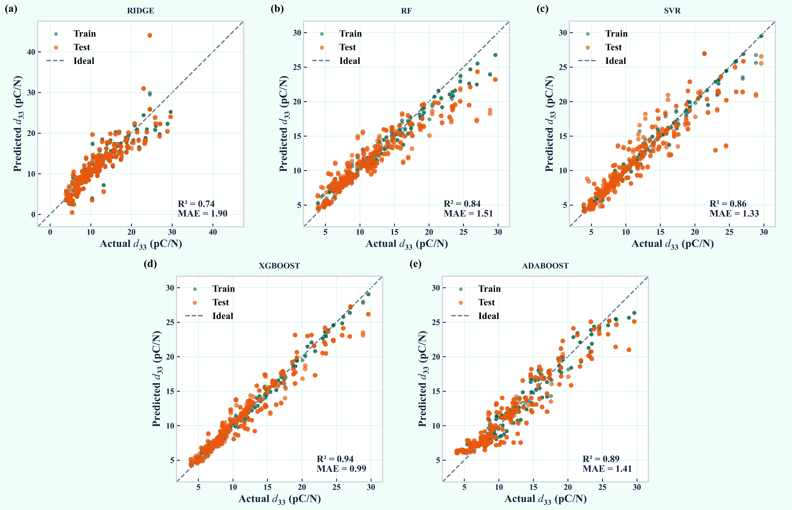

# AlN Machine Learning Data

Data and figures for machine learning of piezoelectric response in aluminum nitride (AlN).

## Train / Test Model Comparison

Predicted versus DFT-calculated d₃₃ for ridge regression, random forest, SVR, XGBoost, and AdaBoost. Each panel identifies the training and test points and shows the ideal prediction line.

## Validation of 20 Structures

The figure compares the model committee's d₃₃ predictions with DFT results for 20 AlN structures.

The [validation CSV](data/top20-validation.csv) lists the structures in figure order and includes their lattice ratios, elastic and piezoelectric coefficients, DFT and ML d₃₃ values, and prediction errors.

## Crystal Structures

Both illustrations are available as 852 × 852 pixel TIFFs at 1320 DPI.

- [Wurtzite AlN](figures/wurtzite-aln.tif)
- [Na–Hf-doped AlN](figures/na-hf-doped-aln.tif)
